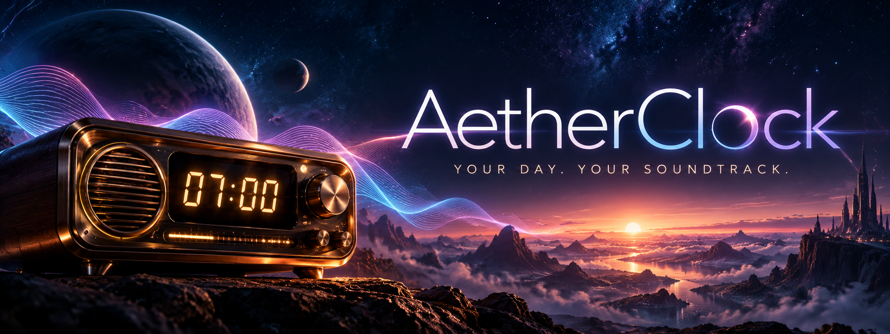

<!-- Banner: assets/banner-*.png pending design; using existing banner meanwhile -->
<picture>
  <source media="(prefers-color-scheme: dark)" srcset="docs/aetherclock-banner.png">
  
</picture>

# AetherClock

**A task-based radio alarm clock for the browser.** Each task in your day rings at its time — and plays music curated by AI for what comes next.

[](https://aetherclock.pages.dev)


> **Status:** live at [aetherclock.pages.dev](https://aetherclock.pages.dev) · actively maintained

---

## What it does

AetherClock turns your daily plan into a broadcast. You define tasks — with time, category and mood — and when the hour strikes, the "radio" tunes in: a voice briefing tells you the time, the weather and what's ahead, then a playlist of 1–5 YouTube tracks plays, picked by Gemini (with Google Search grounding) to match the moment. Rainy Tuesday commute? Night-shift wind-down? The station knows.

If the AI is unavailable or a video is blocked, AetherClock degrades gracefully: verified royalty-free fallback tracks, a local alarm tone — and every fallback is **labelled as such**, never disguised as a curation.

## Try it

Open **<https://aetherclock.pages.dev>** — no install, no API key required.

Use **"Play your own YouTube link"** to test playback instantly. Music only plays while the app is open; a push notification alone does not start music in a closed app (browser limitation).

## Quick start

Requires **Node.js 22+** and **pnpm**.

```bash
git clone https://github.com/deusexlumen/AetherClock.git
cd AetherClock
pnpm install --frozen-lockfile
pnpm dev        # Vite on http://localhost:3000 — UI only
```

The AI endpoint `/api/generate` is a Cloudflare Pages Function, which plain Vite doesn't serve. For the full stack locally:

```bash
pnpm build
pnpm dev:pages  # wrangler pages dev dist --local
```

### Background alarms (push, even when closed)

Push alarms need the Cloudflare side: Pages Functions + KV + D1, plus the scheduled Worker in `cron-worker/`:

```bash
pnpm deploy:cron          # scheduled worker
pnpm generate-vapid       # VAPID keys for push
```

Details and the D1 migration steps (`migrations/0001_alarm_registry.sql`, `0002_ai_request_budgets.sql`) live in [docs/kv-quota-fix.md](docs/kv-quota-fix.md) and [docs/task-alarms.md](docs/task-alarms.md).

## Features

**Task alarms** — Tasks with time, category and mood keywords form a repeating daily plan. Tasks at the same time share one broadcast; standalone alarms still exist. → [docs/task-alarms.md](docs/task-alarms.md)

**AI-curated playlists** — 1–5 YouTube tracks chosen from task context, weather, time of day and genre, via Gemini with Google Search grounding. The app *finds* music, it doesn't generate it. Blocked videos are replaced automatically; the NCS safety net guarantees the alarm never stays silent.

**Voice briefing** — Fenrir, Kore or Leda announces time, weather, upcoming tasks and your custom greeting (Gemini TTS).

**14 neo-retro themes** — including 3 live WebGL scenes (Babylon.js, audio-reactive where the source allows it), Device and Ambient modes, plus a reduced-motion fallback.

**PWA** — installable, service-worker caching, push notifications, offline fallback tone.

**Honest fallbacks** — without AI or an API key, the app says so and uses clearly-labelled generic presets.

**Retro radio UX** — mechanical station tuner, glowing LCD track cards with curation reasons, progressive sunrise volume ramp, 60-second pre-warm engine so playback starts on the second.

## Tech stack

- **React 19 + TypeScript**, Vite 6, Tailwind CSS 3, lucide-react
- **@google/genai** — Gemini text generation with Google Search grounding + Gemini TTS
- **Babylon.js** — live WebGL themes
- **Cloudflare** — Pages Functions, KV, D1, scheduled Worker (`cron-worker/`), web-push
- **Open-Meteo** — weather, free, no API key
- Fonts: Orbitron & Share Tech Mono

## Configuration

| What | Where |
| --- | --- |
| `GEMINI_API_KEY` (optional `GEMINI_API_KEYS` pool) | Cloudflare Pages secrets |
| Personal Gemini key (optional) | app settings — stored in your browser, sent per request, never stored server-side |
| Push / background alarms | Pages Functions, KV, D1 + cron-worker |
| AI routing & budget | [docs/ai-routing.md](docs/ai-routing.md) |

All in-app preferences — voice, playlist, loudness, theme, motion, blacklist, notifications — live in `localStorage` on your device.

## Docs

- [Task alarms](docs/task-alarms.md) — the daily-plan broadcast model
- [AI routing](docs/ai-routing.md) — model selection and request budgets
- [KV quota fix](docs/kv-quota-fix.md) — Cloudflare push-alarm setup
- [Playback validation](docs/playback-validation.md) — how fallbacks are verified
- [LEARNINGS.md](LEARNINGS.md) — engineering log: autoplay policies, CSP workarounds, fallback architecture

## License

Released under the [MIT License](LICENSE) — © 2026 Deus Ex Lumen.

## Contact

Issues & ideas: <https://github.com/deusexlumen/AetherClock/issues>

---

<p><sub>by <a href="https://github.com/deusexlumen">Deus Ex Lumen</a> · <em>Resonanz ist das Einzige, was zählt.</em></sub></p>
